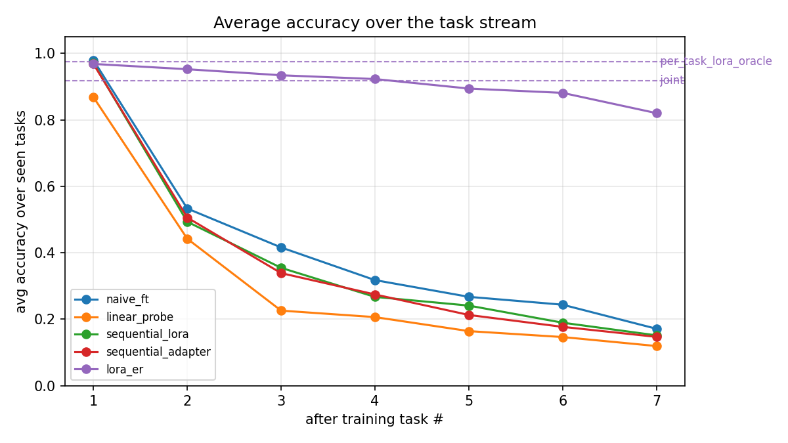
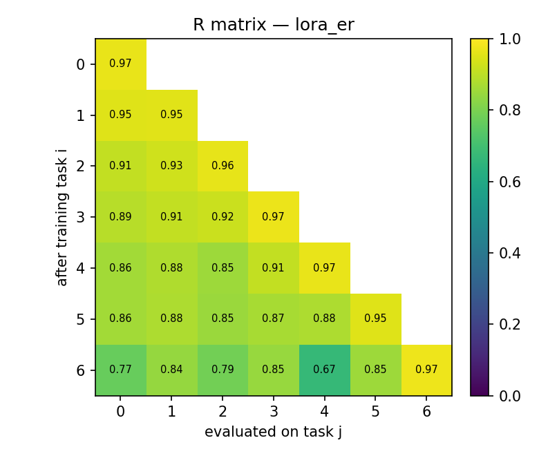

# Continual learning for text classification with LoRA, adapters and replay

Course project for Continual Learning at the University of Pisa (2025/26). It looks at whether parameter-efficient fine-tuning is enough to stop a text classifier from forgetting old classes as new ones arrive, or whether a replay buffer of old examples is also needed. All experiments run on a single 4 GB GPU (GTX 1650 Ti).

**Stack:** Python 3.11, PyTorch 2.5.1, Hugging Face Transformers 4.46.3, PEFT 0.13.2, Datasets 3.1.0, pytest.

**Setting:** Banking77 split into 7 tasks of 11 intents each, a frozen RoBERTa-base, and a classification head that grows as new intents appear. At test time the model chooses from all intents seen so far, without a task ID (class-incremental learning). The full report is in [`report/CL_PEFT_Text_Report.pdf`](report/CL_PEFT_Text_Report.pdf).

**Summary:** LoRA and bottleneck adapters on their own forget almost everything and end at about 0.15 accuracy. A replay buffer of 500 stored examples brings LoRA to 0.82, compared with 0.917 when the same model is trained on all data at once.

<p align="center">
  
  
</p>

## Results

Final accuracy over all 77 classes and average forgetting, seed 42:

| Method               | Accuracy | Forgetting | Notes                                      |
|----------------------|:--------:|:----------:|--------------------------------------------|
| `per_task_oracle`    | 0.975    |            | Task-IL oracle (task ID given at test time) |
| `joint`              | 0.917    |            | upper bound, all data at once              |
| `lora_er`            | 0.820    | 0.168      | LoRA + replay buffer of 500                |
| `naive_ft`           | 0.171    | 0.946      | full fine-tuning, lower bound              |
| `sequential_lora`    | 0.151    | 0.966      | no replay                                  |
| `sequential_adapter` | 0.147    | 0.969      | no replay                                  |
| `linear_probe`       | 0.119    | 0.825      | frozen features, head only                 |

The low forgetting of `linear_probe` is misleading: its accuracy on each task was low to begin with, so there was little to lose.

Three ablations on `lora_er`:

- **LoRA rank** (2, 4, 8, 16, 32): accuracy stays between 0.81 and 0.83, so a larger rank gives no gain.
- **Replay buffer size** (100, 200, 500, 1000): 0.58, 0.72, 0.83, 0.86. This is the parameter that matters.
- **Class order** (3 orderings): 0.835 ± 0.008.

Differences below about 0.01 should be read as noise. The rank-8 and buffer-500 points of the ablations are the same configuration, run at the same code version, and gave 0.827 and 0.833. The main table (0.820) was produced earlier, at a different commit, so I cannot say how much of its gap to those two is code and how much is noise. Seeds and cuDNN determinism are set, but I did not enable fully deterministic algorithms and training runs in fp16 on a GPU, so identical runs are not bit-identical. The main table is a single seed.

Results are stored as CSV and JSON in `results/`, and `scripts.make_figures` regenerates every figure from the saved runs without retraining.

## Implementation details

All seven methods run through one pipeline, selected by a switch in `src/cl/methods.py`, so they share the same data, splits and evaluation.

- **Classifier:** cosine-similarity head. New class vectors are appended and old ones are kept, which reduces the bias toward the most recent classes.
- **Replay buffer:** reservoir sampling that stores token ids, not embeddings. Cached embeddings go stale while LoRA changes the encoder, whereas re-encoding stored ids always uses the current model.
- **Bottleneck adapter:** about 60 lines, attached with forward hooks. The `adapters` library pinned an older `transformers` than the one used here.
- **Tests:** 28 unit tests, plus a smoke test that runs before every long job.

`PROJECT_NOTES.md` documents the environment debugging, including a CUDA/PyTorch wheel mismatch, bf16 being reported as supported on Turing, and a GPU memory leak across runs caused by reference cycles in the PEFT hooks.

## Project structure

```
config/            YAML configs for the data stream and hyper-parameters
src/data/          dataset loading, task stream, tokenisation
src/models/        frozen backbone, cosine head, LoRA, bottleneck adapter
src/cl/            replay buffer, continual trainer, method registry, runner
src/eval/          class-incremental evaluation and metrics
scripts/           entry points
tests/             unit tests
results/           tables, per-run JSON files, figures
report/            full written report (PDF)
PROJECT_NOTES.md   environment problems and how they were solved
```

## Installation & usage

**Requirements:** Python 3.11 (`torch==2.5.1` has no wheels for 3.14) and an NVIDIA GPU with 4 GB or more. Developed and tested on Windows 11. The commands below are the same on Linux apart from the activation line, but I have only run the project on Windows.

```bash
python3.11 -m venv .venv
source .venv/bin/activate          # Windows PowerShell: .\.venv\Scripts\Activate.ps1

# PyTorch first, from the CUDA 12.4 index
pip install torch==2.5.1 --index-url https://download.pytorch.org/whl/cu124
pip install -r requirements.txt

python -c "import torch; print(torch.__version__, torch.cuda.is_available())"   # expect 2.5.1+cu124 True
```

A driver that reports CUDA 13.2 has no matching `torch==2.5.1` wheel, but the `cu124` build runs fine on it. Banking77 and AG News are downloaded from the Hugging Face Hub on the first run.

```bash
python -m pytest tests/ -q
python -m scripts.smoke                 # tiny end-to-end check, takes seconds
python -m scripts.run_experiment        # all 7 methods, about 3.3 h on a GTX 1650 Ti
python -m scripts.make_figures

python -m scripts.run_ablation --ablation rank
python -m scripts.run_ablation --ablation buffer
python -m scripts.run_ablation --ablation order
python -m scripts.make_ablation_figures
```

`--methods lora_er joint` runs a subset, and `--quick` shrinks the ablations for a test run. Each full ablation takes several hours. Settings are in `config/base.yaml` and `config/lora.yaml`.

## Limitations

One dataset, one backbone (RoBERTa-base), one seed in the main table and only seven tasks. Replay is the only method against forgetting that was compared. Regularisation-based methods such as EWC and distillation were not tried. It is a classification task, so the results say nothing about generative models.

## Contact

Marcin Czarnecki, M.Sc. Computer Science (AI), University of Pisa, www.linkedin.com/in/marcin-czarnecki-002488309

Released under the MIT License, see `LICENSE`.
